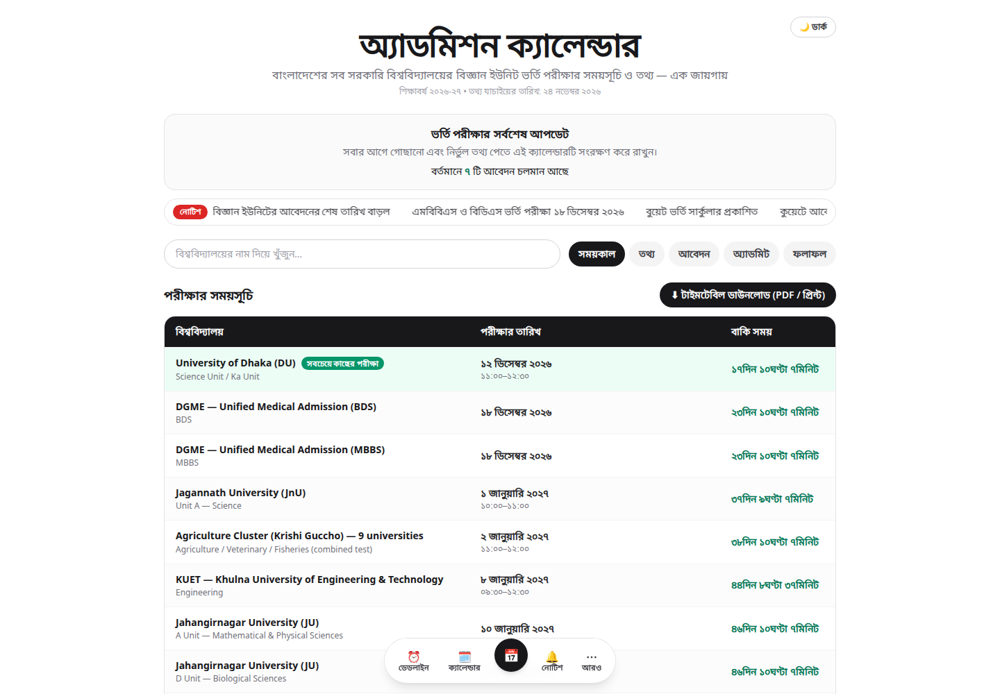

# Admission Calendar 2026–27

A Bengali-language admission information portal for Bangladesh's public
university science / engineering / technology / agriculture / medical
admission tests — exam timetables, applications, admit cards and results in
one place.



## Data source & verification

- **Data verified on: 24 November 2026**
- Data comes from a verified Excel calendar (`src/data/admissions.json`):
  **23 admission tests / systems, 49 master rows / 48 distinct
  universities, 37 sources, 12 notices.**
- **Scope:** public universities' science units only. Private universities
  and Arts / Humanities / Business Studies units are excluded.
- **"Not Announced"** means no official information was found as of
  24 November 2026 — it is not a guess. Dates, fees and GPA requirements
  from the previous session (2025–26) were not reused as 2026–27 facts.
- Where sources disagree (e.g. KUET exam 8 vs 9 January, Agriculture
  Cluster exam 2 vs 3 January), the conflict is shown on the detail page
  under "Notes / Warnings" — it was not silently resolved.

## Features

- **Timeline tab** — timetable table with a black header, a live countdown
  for every exam (updates every 30 seconds), the nearest exam highlighted;
  click a row for details (eligibility, GPA, fee, centres, admit card,
  result, official links, warnings)
- **Info tab** — per-university cards, plus a side-by-side comparison of
  any two universities
- **Application tab** — ongoing applications listed separately, with fee and
  Apply link, days remaining, and expired applications marked
- **Admit Card / Result tabs** — show announced information, or an empty
  state in Bengali when nothing has been announced yet
- **Dashboard** — total universities / tests, published circulars,
  announced exam dates, ongoing applications, upcoming deadlines and exams,
  latest notices
- **Eligibility checker** — enter SSC / HSC GPA, passing years, group and
  subject-wise GPA to see which tests you can apply for
- **Deadline tracker** — official application deadlines, plus your own
  deadlines (saved in the browser)
- **My Calendar** — save your chosen exams (saved in the browser)
- **Notices feed** — new circulars, date changes, extended deadlines
- **Download timetable** — browser print / PDF
- **Dark / light mode** and an **admin panel** — edit, add or delete entries
  and notices (in this browser only, via localStorage), with a button to
  reset to the verified data

## Fonts

- Main Bengali text: **Hind Siliguri** (Google Fonts)
- Numbers (digits in dates, GPA, fees, countdowns, statistics):
  **Anek Bangla**, applied through the `.num` CSS class — Anek Bangla is
  not used for general Bengali text.

## Run locally

```bash
npm install
npm run dev
```

Open `http://localhost:5173` in your browser.

## Production build

```bash
npm run build
npm run preview
```

This creates the `dist/` folder — that is what gets deployed.

## Deploy on Vercel

1. Import this repository in Vercel (https://vercel.com/new).
2. Framework Preset: **Vite** (detected automatically).
3. Build Command: `npm run build`, Output Directory: `dist`.
4. Click Deploy — no environment variables are needed.

## Updating the data

The data lives in `src/data/admissions.json`. When a new circular is
published, update that file from the official source, then rebuild and
redeploy. The admin panel can make temporary changes in the browser, but
permanent updates must go into the JSON file.

## Optional: Supabase (not in v1)

v1 has no backend — data is local JSON, and admin changes and My Calendar
live in the browser's localStorage. To share data between multiple admins /
users, Supabase can be added:

1. Create a project at https://supabase.com and make `admissions`,
   `notices` and `universities` tables — name the columns after the fields
   in `src/data/admissions.json`.
2. Put the project's **anon public key** and URL in `.env`
   (`VITE_SUPABASE_URL`, `VITE_SUPABASE_ANON_KEY`) — never commit a secret
   key to the repository.
3. Install `@supabase/supabase-js` and replace the localStorage-based
   `loadEntries` / `saveEntries` functions in `src/lib/store.ts` with
   Supabase queries (SELECT for reading, UPDATE / INSERT for writing).
4. Add Supabase Auth (email login) to the admin panel, so only authorised
   admins can change data.
5. Verify with `npm run build`, set the environment variables in Vercel,
   and deploy.

## Licence

The information is collected from the official notices of the respective
universities and government bodies; every item's source is listed on the
app's "Sources & Verification" page.
